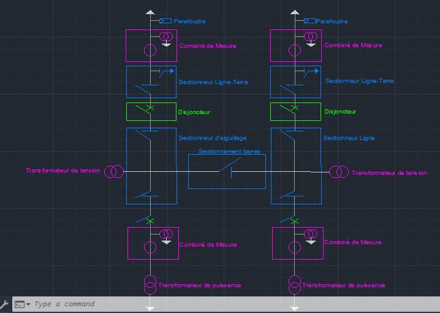
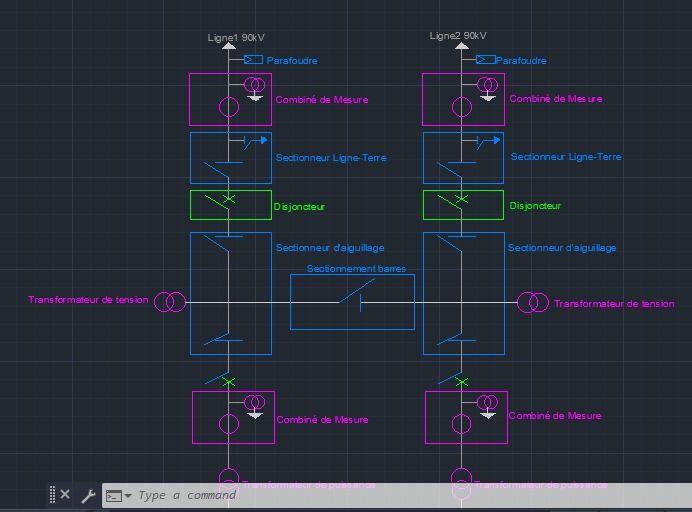

# Structure Poste 90kV/20kV

Conception de la structure d'un poste 90kV/20kV réalisée sous AutoCAD.

## Aperçu du design

## Contenu du dépôt

- `Structure poste.dwg` : plan AutoCAD source
- `Structure poste-Layout1.pdf` : mise en page (Layout1) exportée en PDF
- `images/` : captures du schéma